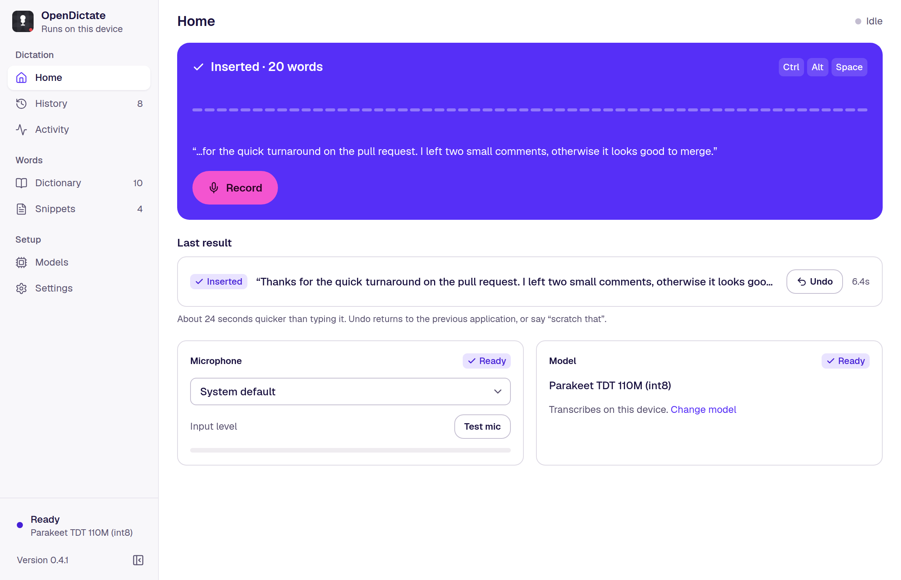
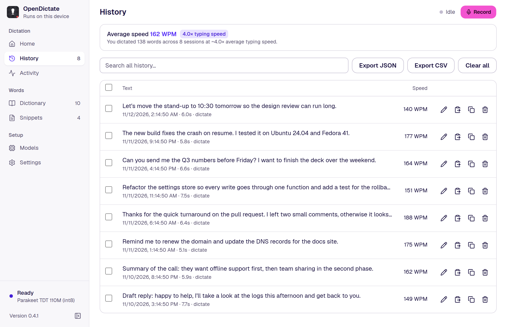
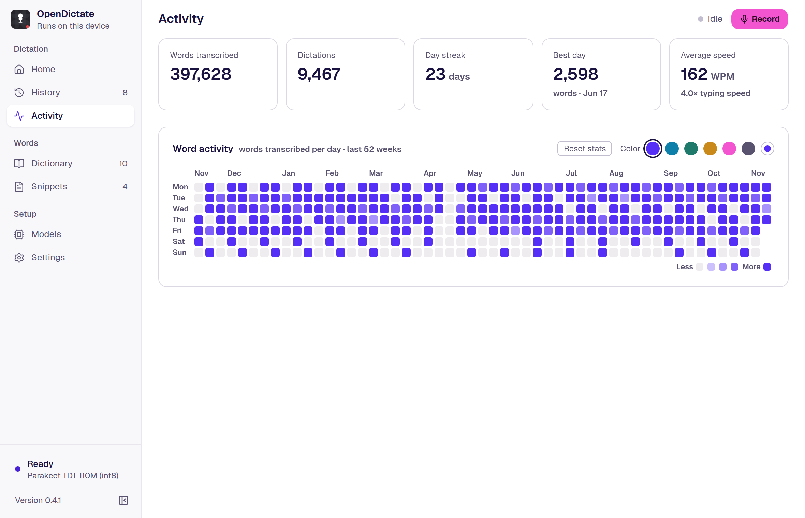
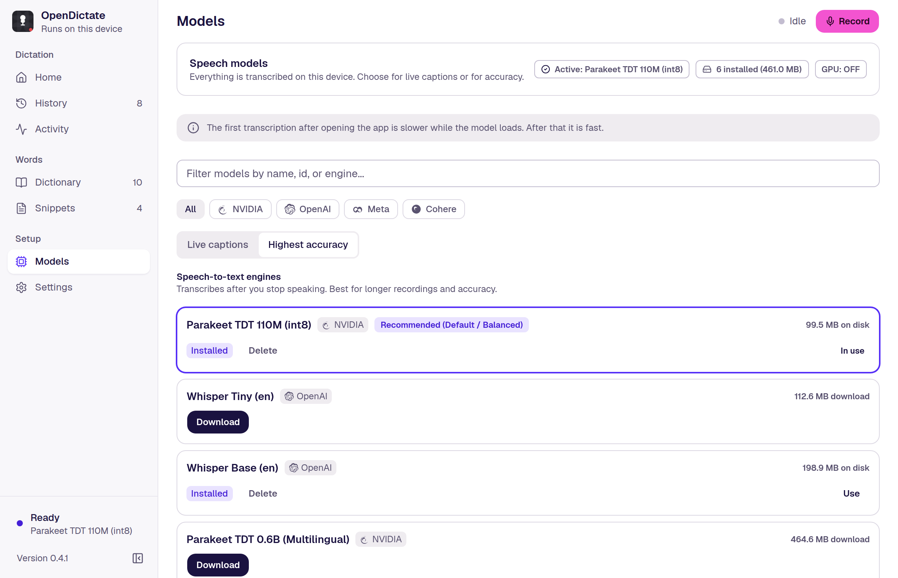
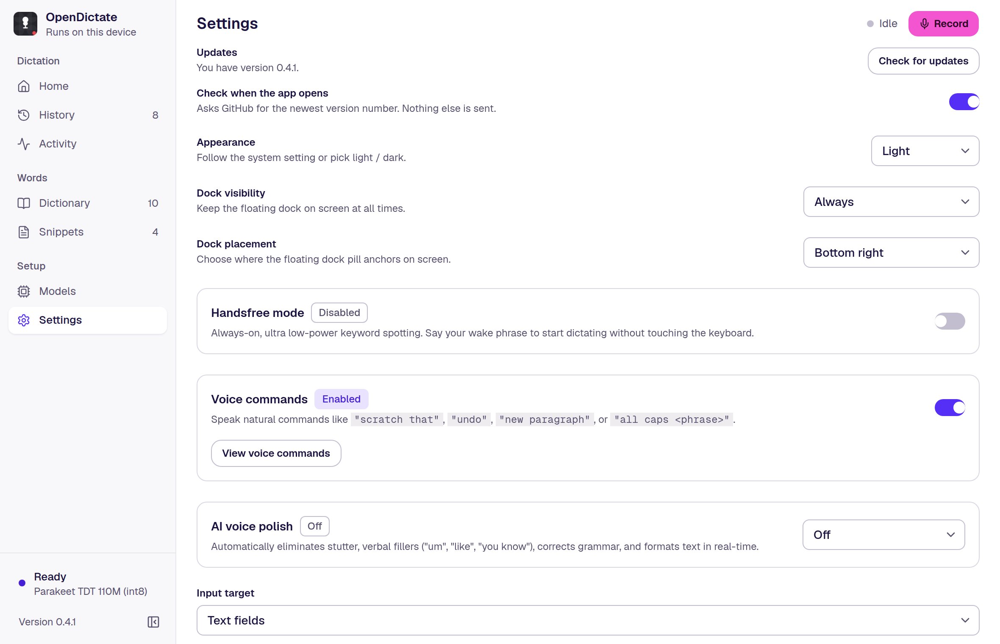
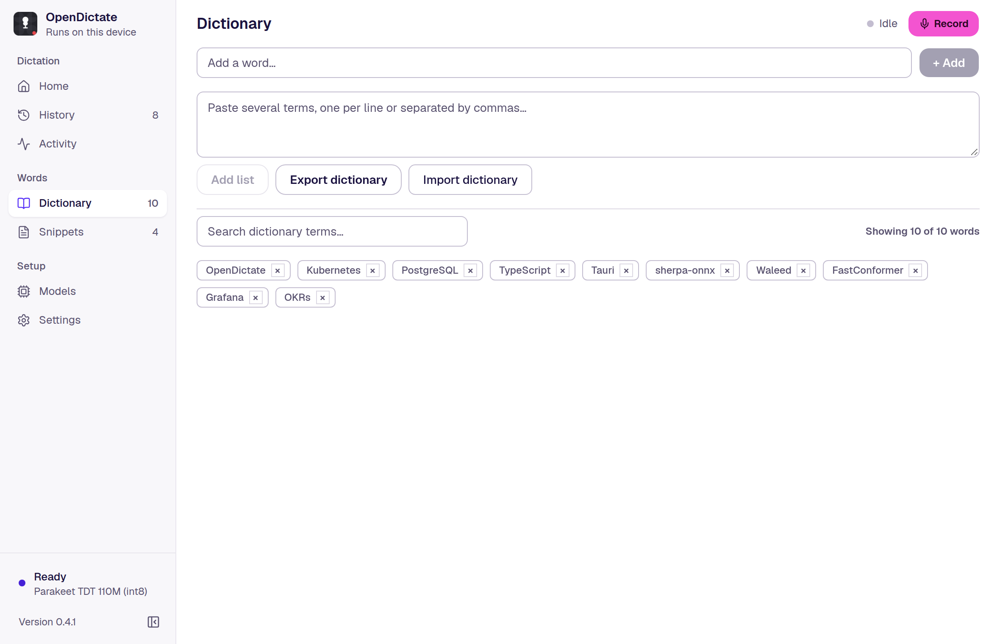
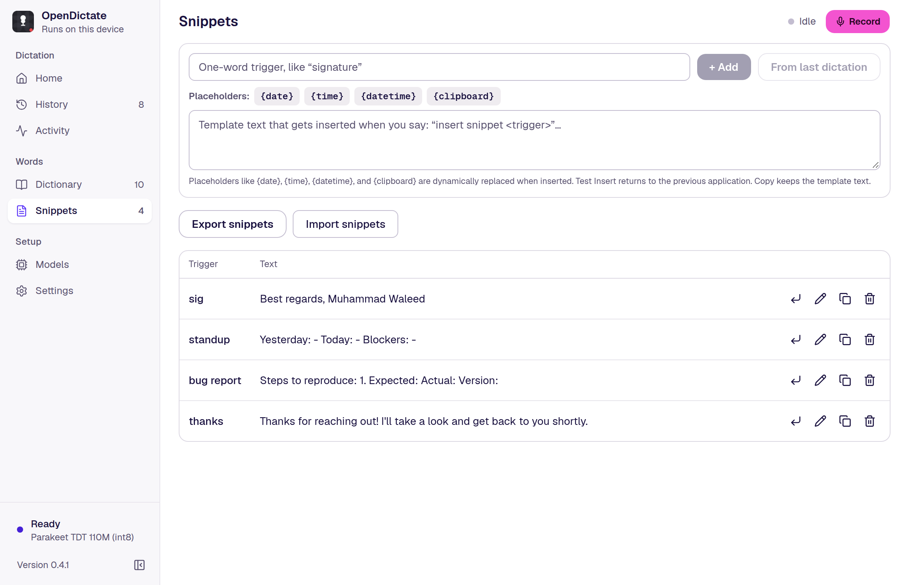

<p align="center">
  <h1 align="center">OpenDictate</h1>
  <p align="center"><strong>Free, open-source, local-first AI voice dictation for your desktop.</strong></p>
  <p align="center">Press a hotkey, speak naturally, and your words are instantly typed into whatever app has focus — with zero cloud, zero telemetry, and zero subscription fees.</p>
</p>

<p align="center">
  <a href="https://github.com/Muhammad-Waleed381/OpenDictate/releases/latest"></a>
  
  <a href="LICENSE"></a>
  <a href="https://tauri.app"></a>
  <a href="https://github.com/Muhammad-Waleed381/OpenDictate/stargazers"></a>
</p>

<p align="center">
  <a href="https://opendictate.vercel.app"><strong>Website</strong></a> &nbsp;•&nbsp;
  <a href="https://opendictate.vercel.app/docs"><strong>User guide</strong></a> &nbsp;•&nbsp;
  <a href="https://github.com/Muhammad-Waleed381/OpenDictate/releases/latest"><strong>Download</strong></a> &nbsp;•&nbsp;
  <a href="CONTRIBUTING.md"><strong>Contributing</strong></a>
</p>

<p align="center">
  <picture>
    <source media="(prefers-color-scheme: dark)" srcset="docs/screenshots/home-dark.png">
    
  </picture>
</p>

---

## Download

Get the installer for your system from the [latest release](https://github.com/Muhammad-Waleed381/OpenDictate/releases/latest).

| Windows | macOS | Linux |
| :---: | :---: | :---: |
| `-setup.exe` (recommended) or `.msi` | Universal `.dmg` | `.AppImage`, `.deb` or `.rpm` |
| Windows 10 / 11, x64 | Apple Silicon and Intel | x86_64 |
| **NVIDIA GPU:** `_x64-cuda-setup.exe` | | **NVIDIA GPU:** `_amd64-cuda.deb` |

The `-cuda` installers run speech models on an NVIDIA GPU. They need the NVIDIA driver, CUDA 12 and cuDNN 9, and fall back to the CPU without them. See [GPU acceleration](#gpu-acceleration).

On first launch a three-step setup picks your microphone, downloads a speech model (about 104 MB for the default) and sets your shortcut.

The installers are not code-signed yet, so Windows SmartScreen and macOS Gatekeeper may warn you the first time you open the app.

Once installed, OpenDictate tells you when a new version is out and can install it for you. See [Updates](#updates).

---

## 🥊 Why OpenDictate? (Comparison with Alternatives)

Cloud dictation tools require sending raw audio across the internet, paying recurring monthly fees, and suffer from network latency. OpenDictate runs state-of-the-art speech models **100% locally on your hardware** — after a one-time model download, voice typing is fast, completely private, and free forever.

| Feature | **OpenDictate** | **Wispr Flow** | **Superwhisper** | **Apple / Windows Dictation** |
| :--- | :---: | :---: | :---: | :---: |
| **Pricing** | **100% Free & Open Source (MIT)** | \$12 – \$20 / month | \$8 / month or \$199 | Built-in |
| **Privacy & Cloud** | **100% Local (Zero Cloud Required)** | Cloud API dependency | Local (Mac only) | Cloud / Telemetry |
| **Platform Support** | **Linux, macOS, Windows** | Mac & Windows | macOS only | Single OS |
| **AI Speech Models** | **Whisper, FastConformer, Parakeet, Omnilingual, Cohere** | Proprietary Cloud | Whisper | Proprietary |
| **Voice Actions / Coding** | **Yes** (Casing, navigation, undo, edit) | Partial | Partial | Basic |
| **Custom Dictionary** | **Yes** (Hotword boosting) | Yes | Yes | Limited |
| **Telemetry / Tracking** | **Zero Telemetry** | Analytics tracked | Basic analytics | OS telemetry |

---

## Features

### Dictation
- **One shortcut everywhere.** <kbd>Ctrl</kbd>+<kbd>Alt</kbd>+<kbd>Space</kbd> on Windows and Linux, <kbd>⌘</kbd>+<kbd>⇧</kbd>+<kbd>Space</kbd> on macOS. You can change it in Settings.
- **Toggle or hold-to-talk.** Press once to start and again to stop, or hold the keys while you speak. Hold-to-talk isn't available on GNOME, where shortcuts only report the key press.
- **Double-tap shortcuts on macOS.** Double-tap Fn, ⌘, ⌃, ⌥ or ⇧ to start dictating.
- **Hands-free mode.** Say a wake phrase ("hey dictate" or "computer" by default) to start. OpenDictate goes back to sleep after a period of silence that you choose, or when you say "go to sleep".
- **Live captions.** A small floating dock shows what you're saying as you say it.
- **Undo.** Take back the last insert with the Undo button, the tray menu, or by saying "scratch that".

### Voice commands
Commands work when you say them on their own. Ordinary sentences are typed as text. You can turn commands off in Settings.

| What you want | Say |
| :--- | :--- |
| Undo | "scratch that", "undo that" |
| Delete | "delete word", "delete line", "clear all" |
| New line / paragraph / tab | "new line", "new paragraph", "tab" |
| Bullet | "bullet point" |
| Change case | "all caps …", "camel case …", "snake case …", "title case …" |
| Browser tabs and scrolling | "new tab", "close tab", "next tab", "previous tab", "scroll down", "scroll up" |
| Send to a chat or AI tool | "send prompt …", "ask claude …" (or cursor, codex, chatgpt), "send", "submit" |
| Stop a running command | "interrupt", "stop process" |
| Open things | "search for …", "google for …", "open website …", "switch to Slack", "open app Figma" |
| Snippets | "insert snippet sig", "paste snippet standup" |

`git push`, `git pull` and other risky commands are only ever typed, never run. Say "send" to run them yourself. The full list is under **Settings → Voice commands → View voice commands**.

### Words
- **Dictionary.** Add names, jargon and acronyms. Your spelling and capitalization are applied to every transcript, and streaming models that support it are also biased toward your terms. Import and export as a text file.
- **Snippets.** Save text you type often and insert it by voice. Templates can use `{date}`, `{time}`, `{datetime}` and `{clipboard}`. Import and export as JSON.
- **Spoken punctuation** (optional). Say "comma", "period", "question mark" or "exclamation point" and get the symbol.
- 🪄 **Optional AI Voice Polish** — Clean up disfluencies, remove filler words ("um", "ah"), or auto-format raw thoughts into bullet points using local SLMs or cloud LLMs (Groq).

### History and activity
- **History.** Every dictation with its time, length and speed. Search all of it, edit an entry, copy or re-insert it, and export to JSON or CSV. When you fix a word in History, the app offers to add it to your Dictionary.
- **Activity.** Words transcribed, number of dictations, day streak, best day, average speed compared with typing, and a year-long heatmap.

### Comfort and control
- **Dock visibility.** Show the dock always, only while dictating, or never. "Only while dictating" or "Never" is a good choice on OLED screens. You can also pick which corner it sits in.
- **Terminal mode.** Set the input target to "Shell (Bash, Zsh)" and editing commands use terminal-friendly keys. Undo is turned off there, because Ctrl+Z would suspend the running program.
- **Light, dark or system theme**, a collapsible sidebar (<kbd>Ctrl</kbd>/<kbd>⌘</kbd>+<kbd>B</kbd>), optional sounds, start with your computer, and a tray menu.
- 🔒 **100% Private & Offline** — No accounts, no subscriptions, and no telemetry. After model downloads, the only automatic network call is a version check against GitHub when the app opens, which you can turn off in Settings.

<p align="center">
  
</p>

---

## Screenshots

| History | Activity |
| :---: | :---: |
|  |  |
| **Models** | **Settings** |
|  |  |
| **Dictionary** | **Snippets** |
|  |  |

---

## Speech models

Pick and download models in the **Models** tab. They come from the [sherpa-onnx](https://github.com/k2-fsa/sherpa-onnx) model releases and run on your CPU.

Speeds were measured on a 4-core laptop CPU (Intel Core i5-8350U, no GPU) with real speech, as time spent per second of audio. **0.1× means 10 seconds of speech takes about 1 second.** Newer CPUs are faster. To time models on your own machine, run `cargo run --release -p opendictate-core --example bench_inference -- <16 kHz wav>`.

### Transcribe after you stop speaking

| Model | From | Download | Languages | Speed | Notes |
| :--- | :--- | :---: | :--- | :---: | :--- |
| **Parakeet TDT 110M (int8)** | NVIDIA | ~104 MB | English | ~0.03× | **Default.** Fast and accurate on modest CPUs. |
| Parakeet TDT 0.6B v3 | NVIDIA | ~487 MB | Multilingual | ~0.1× | Higher accuracy, several languages. |
| Parakeet Unified En 0.6B | NVIDIA | ~501 MB | English | ~0.12× | Punctuation and casing built in. |
| Whisper Tiny (en) | OpenAI | ~118 MB | English | Not measured | Smallest Whisper. |
| Whisper Base (en) | OpenAI | ~209 MB | English | ~0.15× | |
| Whisper Small (en) | OpenAI | ~636 MB | English | Not measured | |
| Whisper Turbo (Large v3) | OpenAI | ~564 MB | Multilingual | ~0.6–0.8× | Large v3 accuracy. Slow without a GPU. |
| Whisper Medium (en) | OpenAI | ~1.9 GB | English | Not measured | |
| Omnilingual ASR 300M | Meta | ~293 MB | 1600+ languages | Not measured | For languages other models don't cover. |
| Cohere Transcribe 2B (int8) | Cohere | ~1.7 GB | 14 languages | Not measured | Arabic, Chinese, Dutch, English, French, German, Greek, Italian, Japanese, Korean, Polish, Portuguese, Spanish, Vietnamese. |

The language picker in Settings applies to Whisper and Cohere. The other models work out the language themselves or only support English.

### Transcribe while you speak

| Model | From | Download | Speed | Notes |
| :--- | :--- | :---: | :---: | :--- |
| FastConformer 80ms (Streaming) | NVIDIA | ~125 MB | ~0.25× | Text is ready about 0.3 s after you stop. |
| Parakeet Unified 0.6B (Streaming) | NVIDIA | ~501 MB | ~4–5× | Too slow for live use on this laptop; needs a fast CPU or a GPU. The Models tab measures your machine and warns you. |

### Helper models

These download on their own when needed.

| Model | Download | Used for |
| :--- | :---: | :--- |
| Zipformer EN 20M | ~29 MB | Live captions in the dock (English). |
| Silero VAD v4 | ~0.6 MB | Detecting when you start and stop speaking. |
| Zipformer 3.3M (KWS) | ~16 MB | Wake phrases in hands-free mode. |

### GPU acceleration

The standard installers run models on the CPU, which is fast enough for the default model on any recent machine. For the larger models, the **CUDA installers** (`_amd64-cuda.deb` for Linux, `_x64-cuda-setup.exe` for Windows) run them on an NVIDIA GPU:

1. Install the NVIDIA driver, the CUDA 12 runtime and cuDNN 9.
2. Install the `-cuda` package from the [latest release](https://github.com/Muhammad-Waleed381/OpenDictate/releases/latest).
3. Leave **Settings → GPU acceleration** on **Auto**, or pick **CUDA**.

The Models tab shows `GPU: cuda` while a model runs on the GPU. If the GPU can't be used, the app falls back to the CPU. Details are in [docs/GPU.md](docs/GPU.md).

---

## Platform notes

| | Windows | macOS | Linux |
| :--- | :--- | :--- | :--- |
| **Status** | Supported | Supported | Supported |
| **Typing into apps** | Clipboard + Ctrl+V | Clipboard + ⌘V | Clipboard + Ctrl+V (Ctrl+Shift+V in terminal mode) |
| **Start with system** | Registry `Run` key | LaunchAgent | XDG autostart entry |
| **Packages** | `.exe` (NSIS), `.msi` | Universal `.dmg` | `.AppImage`, `.deb`, `.rpm` |

**Linux**
- To send keystrokes, OpenDictate tries a virtual keyboard on `/dev/uinput` first, then `ydotool`, `wtype` and `xdotool`. At least one of them has to work on your system. See the [troubleshooting guide](https://opendictate.vercel.app/docs#troubleshooting) for `/dev/uinput` access.
- It copies text with `wl-copy`, `xclip` or `xsel`, whichever is installed.
- On GNOME the shortcut is registered as a GNOME custom keyboard shortcut, and it toggles dictation.
- "switch to <app>" uses `wmctrl`, `xdotool`, `swaymsg` or `gtk-launch`.

**macOS**
- Allow microphone access when asked, and give OpenDictate Accessibility access (System Settings → Privacy & Security → Accessibility) so it can paste into other apps and use double-tap shortcuts.

**Windows**
- "switch to <app>" can only switch to apps that are already open. It doesn't launch them.
- An `.msi` install can't update itself. Use the `-setup.exe` installer if you want one-click updates.

---

## Updates

When a new version is out, OpenDictate shows a prompt. If your copy can update itself, **Update now** downloads the installer for your system, checks it against the SHA-256 checksum published with the GitHub release, installs it and restarts. On Linux `.deb` and `.rpm` installs you'll be asked for your password. The CUDA version always updates to the next CUDA version. If your copy can't update itself, the button opens the download page.

The app checks for updates when it opens and every 12 hours while it runs. You can turn that off under **Settings → Updates**.

---

## 🔒 Privacy Guarantee

OpenDictate is built on strict local-first principles:
- **Zero Audio Transmission**: Your voice is processed directly on your CPU/GPU and never leaves your device.
- **Zero Telemetry / Analytics**: No tracking pixels, analytics beacons, or remote logging.
- **Local Storage**: Dictionary words, snippets, and dictation history are kept in a local SQLite file in your user data directory.

---

## How it works

```
Microphone ──► Audio capture (PulseAudio / ALSA on Linux, cpal elsewhere)
                    │
     ┌──────────────┼───────────────────────────┐
     ▼              ▼                           ▼
Live captions   Speech detection            Wake phrase spotting
(Zipformer 20M) (Silero VAD, energy gate)   (hands-free mode)
                    │
                    ▼
            Speech recognition
  (Parakeet, Whisper, FastConformer, Omnilingual, Cohere)
                    │
                    ▼
     Voice commands, snippets, spoken punctuation,
          dictionary spelling, optional AI polish
                    │
                    ▼
       Clipboard + paste shortcut into the active app
 (uinput / ydotool / wtype / xdotool on Linux, enigo on Windows and macOS)
```

The app is a [Tauri 2](https://tauri.app) desktop app: a React and TypeScript interface (`src/`), a Rust backend (`src-tauri/`), and a Rust core for audio, models and text processing (`crates/opendictate-core/`) built on [sherpa-onnx](https://github.com/k2-fsa/sherpa-onnx).

---

## Building from source

### Prerequisites
- **Node.js** and npm (CI uses Node 24)
- **Rust** stable
- **CMake** and a C++ compiler, for the native sherpa-onnx bindings

On Ubuntu or Debian, also install:

```bash
sudo apt update
sudo apt install -y libwebkit2gtk-4.1-dev libappindicator3-dev librsvg2-dev patchelf \
  libasound2-dev libpulse-dev libudev-dev libgtk-3-dev pkg-config cmake build-essential
```

### Run and build

```bash
git clone https://github.com/Muhammad-Waleed381/OpenDictate.git
cd OpenDictate
npm install

npm run tauri dev     # run the app in development mode
npm test              # frontend tests (Vitest)
cargo test --workspace  # Rust tests
npm run tauri build   # build installers for your platform
```

Release installers for all three platforms are built by GitHub Actions when a `v*` tag is pushed.

To refresh the screenshots in this README, build the frontend, serve it with `npx vite preview --port 4173`, and run `node scripts/take-screenshots.mjs`. The script uses a mocked backend, so no install is needed.

---

## Contributing

Bug fixes, new models, voice commands and UI work are all welcome. Read the [contributing guide](CONTRIBUTING.md) to get started.

---

## License

[MIT](LICENSE) © Muhammad Waleed.

Model names belong to their respective owners (NVIDIA, OpenAI, Meta, Cohere, Silero, Next-gen Kaldi). Each model is distributed under its own license.

> *All product names, logos, and brands mentioned (such as Wispr Flow, Superwhisper, Apple Dictation, Windows Speech Recognition) are property of their respective owners. All company, product, and service names used in this document are for identification and comparative purposes only. Use of these names does not imply any endorsement or affiliation.*
